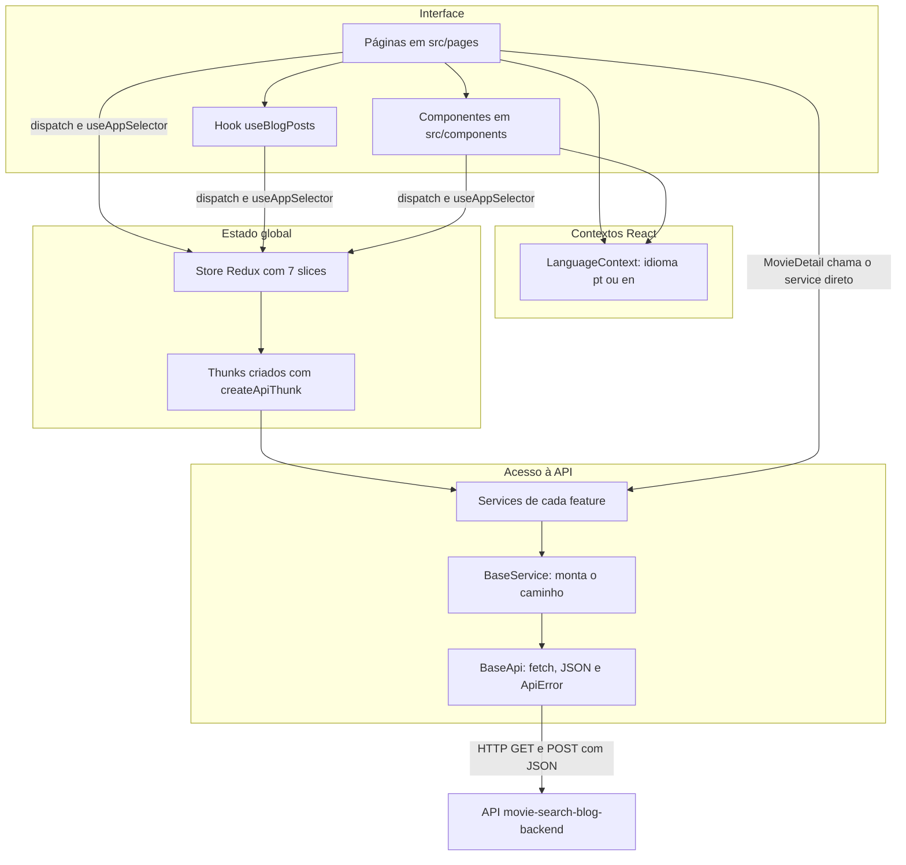
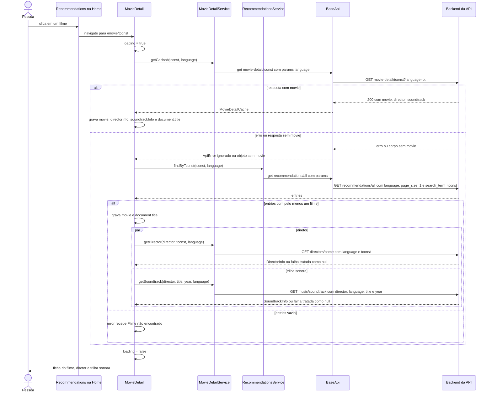

# Arquitetura

Este documento descreve como o frontend está organizado: pastas, roteamento, estado global, acesso à API, contextos, idioma e estilos. Ele reflete o diretório de trabalho atual, incluindo a camada `src/lib/` e os arquivos `service/` de cada feature, que ainda não estão commitados.

## Visão geral

A aplicação é uma SPA React 18 montada em `src/main.tsx` dentro de `<StrictMode>`. O componente `App` (`src/App.tsx`) empilha os provedores nesta ordem, de fora para dentro:

1. `LanguageProvider` (idioma pt/en).
2. `Provider` do `react-redux`, com a `store`.
3. `BrowserRouter` do `react-router-dom`.
4. `ThemedApp`, que aplica `lightTheme` com o `ThemeProvider` do styled-components, injeta `GlobalStyles` e declara as rotas.

A única página que não passa pelo Redux é `MovieDetail`: ela chama `MovieDetailService` e `RecommendationsService` diretamente e guarda o resultado em estado local (`useState`).

## Estrutura de pastas

| Caminho | Papel |
| --- | --- |
| `src/main.tsx` | Ponto de entrada. Monta `<App />` em `#root`. |
| `src/App.tsx` | Provedores e tabela de rotas. |
| `src/pages/` | Uma pasta por página. Cada uma tem `index.tsx` e, na maioria, `styles.ts`. `CompleteArticle` tem também `Components.tsx` e `sectionTitles.ts`; `Home` tem `components/PostCardList.tsx`. |
| `src/components/` | Componentes compartilhados (layout, barra superior, card, mensagens, carrossel de recomendações). Ver [componentes.md](componentes.md). |
| `src/features/` | Uma pasta por domínio de dados. Cada uma reúne o slice Redux, os tipos e um `service/` com as chamadas HTTP. `movieDetail` só tem `service/` e `types.ts`, sem slice. |
| `src/lib/api/` | Infraestrutura de API: `BaseApi.ts` (cliente HTTP), `errors.ts` (`ApiError` e utilitários), `thunk.ts` (`createApiThunk` e `addStatusCases`), `types.ts` (`ApiResponse`, `EntriesResponse`, `AsyncStatus`). |
| `src/lib/service/` | `BaseService.ts`, classe base dos services. |
| `src/store/` | `store.ts` (configuração), `hooks.ts` (`useAppDispatch`, `useAppSelector`), `types.ts` (tipos `RootState`, `AppDispatch`, `AppStore`). |
| `src/contexts/` | `LanguageContext.tsx`, o único contexto próprio da aplicação. |
| `src/hooks/` | `useBlogPosts.ts`, usado pela Home. |
| `src/styles/` | `theme.ts` (o tema único, `lightTheme`) e `GlobalStyles.ts`. |
| `src/utils/` | `dateUtils.ts` (`parseDate`, `formatDate`). |
| `src/types/` | `blog.ts`, com a interface `BlogPost`. Nenhum arquivo a importa. |
| `public/` | `popcorn-icon.svg`, o favicon. |

## Roteamento

As rotas ficam em `ThemedApp`, dentro de `src/App.tsx`. A última rota é a coringa (`*`), que mostra a página `NotFound` para qualquer endereço desconhecido.

| Caminho | Página | Arquivo |
| --- | --- | --- |
| `/` | `Home` | `src/pages/Home/index.tsx` |
| `/article/:movieId` | `CompleteArticle` | `src/pages/CompleteArticle/index.tsx` |
| `/movie/:movieId` | `MovieDetail` | `src/pages/MovieDetail/index.tsx` |
| `/reviews` | `Reviews` | `src/pages/Reviews/index.tsx` |
| `/blogroll` | `Blogroll` | `src/pages/Blogroll/index.tsx` |
| `/favorites` | `Favorites` | `src/pages/Favorites/index.tsx` |
| `/blog` | `Blog` | `src/pages/Blog/index.tsx` |
| `*` | `NotFound` | `src/pages/NotFound/index.tsx` |

O parâmetro `:movieId` é sempre um `tconst`. `CompleteArticle` também renderiza `NotFound` quando o filme não tem post nem crítica. A página `src/pages/Review/index.tsx` existe, mas não está associada a nenhuma rota e não é importada em lugar nenhum.

A navegação é feita com `useNavigate`: os itens de menu e os cards são elementos com `onClick`. O único `<Link>` da aplicação é o de volta para `/` na página `NotFound`.

## Store Redux

A store é criada em `src/store/store.ts` com `configureStore` e sete reducers. Não há middleware adicional, persistência nem RTK Query.

| Chave em `RootState` | Arquivo do slice | `name` do slice | Para que serve |
| --- | --- | --- | --- |
| `authoralReview` | `features/authoralReview/authoralReviewSlice.ts` | `authoralReview` | Crítica autoral de um filme. |
| `blogPost` | `features/blogPost/blogPostSlice.ts` | `blogPost` | Post de blog de um filme. |
| `blogPostImages` | `features/blogPost/blogPostImagesSlice.ts` | `uploadImages` | Imagens de um filme e capas por `tconst`. |
| `blogPostsAndReviews` | `features/blogPostsAndReviews/blogPostsAndReviewsSlice.ts` | `blogPostsAndReviews` | Cards da Home e a lista combinada de posts e críticas. |
| `favorites` | `features/favorites/favoritesSlice.ts` | `favorites` | Lista de favoritos e o favorito do filme aberto. |
| `recommendations` | `features/recommendations/recommendationsSlice.ts` | `recommendations` | Filmes recomendados do carrossel da Home. |
| `writeReviews` | `features/writeReviews/writeReviewsSlice.ts` | `reviews` | Lista de críticas da página `/reviews`. |

### Forma do estado

Todos os slices têm um campo `error: string | null` e pelo menos um campo de status do tipo `AsyncStatus` (`'idle' | 'loading' | 'succeeded' | 'failed'`).

| Slice | Campos | Valor inicial |
| --- | --- | --- |
| `authoralReview` | `data: AuthoralReview \| null`, `error`, `status` | `data: null`, `status: 'idle'` |
| `blogPost` | `data: BlogPostEntry \| null`, `error`, `status` | `data: null`, `status: 'idle'` |
| `blogPostImages` | `imageUrls: string[]`, `subtitles: { en, pt }[]`, `coverImages: Record<string, string>`, `error`, `status` | listas vazias, `coverImages: {}`, `status: 'idle'` |
| `blogPostsAndReviews` | `cardsData: BlogPostCardsResponse \| null`, `data: CombinedResponse \| null`, `error`, `status`, `postsAndReviewsStatus` | `cardsData: null`, `data` com `blogPosts.entries` e `reviews.entries` vazios, ambos os status em `'idle'` |
| `favorites` | `data: FavoritesSearchResponse \| null`, `currentFavorite: FavoritesEntry \| null`, `initialFetchDone: boolean`, `error`, `status` | `data: null`, `currentFavorite: null`, `initialFetchDone: false`, `status: 'idle'` |
| `recommendations` | `data: Recommendation[]`, `total: number`, `error`, `status` | `data: []`, `total: 0`, `status: 'idle'` |
| `writeReviews` | `data: ReviewsSearchResponse \| null`, `error`, `status` | `data: null`, `status: 'idle'` |

### Thunks

Todos os thunks são criados com `createApiThunk(type, fn, fallbackMessage)`.

| Thunk | Tipo da ação | Argumento | O que chama | O que grava no estado |
| --- | --- | --- | --- | --- |
| `fetchAuthoralReview` | `authoralReview/fetchById` | `tconst: string` | `AuthoralReviewService.getByTconst` | `authoralReview.data` (ou `null` se a API responder 404), com `created_at` passado por `formatDate`. |
| `fetchBlogPost` | `blogPost/fetchById` | `tconst: string` | `BlogPostService.getByTconst` | `blogPost.data` (ou `null` em 404), com `created_at` passado por `formatDate`. |
| `fetchAllImageUrls` | `/uploadImages/fetchAllImageUrls` | `{ tconst }` | `ImagesService.list` | `blogPostImages.imageUrls` e `subtitles`. Legendas ausentes viram `'Movie scene'` e `'Cena do filme'`. |
| `fetchCoverImage` | `uploadImages/fetchCoverImage` | `{ tconst }` | Cache API do navegador e, se não houver, `ImagesService.list` | `blogPostImages.coverImages[tconst]` com a URL da primeira imagem. Só o caso `fulfilled` é tratado; não mexe em `status` nem em `error`. |
| `fetchBlogPostCards` | `blogPosts/fetchBlogPostCards` | `SearchParams` | `HomeService.cards` | `blogPostsAndReviews.cardsData`, controlado por `status`. |
| `fetchBlogPostsAndReviews` | `blogPosts/fetchBlogPostsAndReviews` | `SearchParams` | `HomeService.cards` e `WriteReviewsService.search` em paralelo | `blogPostsAndReviews.data`, controlado por `postsAndReviewsStatus`. |
| `searchFavorites` | `favorites/search` | `FavoritesSearchParams` | `FavoritesService.search` | `favorites.data` e `initialFetchDone = true`. |
| `getFavoriteById` | `favorites/getById` | `tconst: string` | `FavoritesService.getByTconst` | `favorites.currentFavorite`. |
| `fetchRandomRecommendations` | `recommendations/fetchRandom` | `{ language? }` | `RecommendationsService.random` | Acrescenta a `recommendations.data` os filmes cujo `tconst` ainda não está na lista e grava `total`. |
| `fetchAllAuthoralReviews` | `review/fetchAllAuthoral` | `ReviewsSearchParams` | `WriteReviewsService.search` | `writeReviews.data`. |

Detalhes que valem atenção:

- `searchFavorites` e `getFavoriteById` usam o mesmo campo `favorites.status` e o mesmo `favorites.error`.
- `fetchBlogPostsAndReviews` busca as críticas sempre com `page: 1` e `pageSize: 10`, qualquer que seja o `pageSize` recebido. O `pageSize` do argumento vale só para os cards de posts.
- As datas dos cards (`created_at`) são convertidas de ISO para `dd/MM/yyyy` com `date-fns` dentro do próprio thunk (`formatDateFromISO`). Datas vazias viram `'Data não disponível'` e datas inválidas viram `'Data inválida'`.
- `fetchCoverImage` guarda a resposta de `GET images/{tconst}` na Cache API, no cache `movie-images-cache`, com a chave `/images/{tconst}`. Não há expiração.

### Ações síncronas

| Ação | Slice | Efeito |
| --- | --- | --- |
| `clearAuthoralReviewState` | `authoralReview` | Zera `data` e `error` e volta `status` para `'idle'`. |
| `clearBlogPostState` | `blogPost` | Zera `data` e `error` e volta `status` para `'idle'`. |
| `clearImageState` | `blogPostImages` | Zera `imageUrls`, `subtitles` e `error` e volta `status` para `'idle'`. Mantém `coverImages`. |
| `clearFavoriteState` | `favorites` | Zera `currentFavorite` e `error`. Não altera `status`. |

### `createApiThunk` e `addStatusCases`

`src/lib/api/thunk.ts` concentra o padrão repetido em todos os slices.

- `createApiThunk` executa a função recebida e, se ela lançar, devolve `rejectWithValue({ message, status })`. A `message` é sempre o texto de reserva passado na criação do thunk; a mensagem que veio do backend não chega ao estado.
- `addStatusCases(builder, thunk, statusKey, onFulfilled?)` liga os três casos do thunk a um campo de status do slice: `pending` grava `'loading'` e limpa `error`; `fulfilled` grava `'succeeded'` e chama `onFulfilled`; `rejected` grava `'failed'` e copia `action.payload.message` para `error`.

## Acesso à API

### Camadas

1. **`BaseApi`** (`src/lib/api/BaseApi.ts`) é o cliente HTTP, exportado como instância única. Usa o `fetch` nativo; não há axios.
2. **`BaseService`** (`src/lib/service/BaseService.ts`) é a classe abstrata dos services. Cada subclasse define `prefix` (o recurso) e métodos com nome de operação de negócio.
3. **Services de feature** (`src/features/*/service/*.ts`) são instâncias únicas que estendem `BaseService`.

O comentário em `BaseService` registra a regra do projeto: nenhuma URL deve ser montada fora de um service.

### URL base e variável de ambiente

`BaseApi.url` lê `import.meta.env.VITE_MOVIE_SEARCH_BLOG_API_URL` a cada requisição, remove barras finais e lança um `Error` se a variável estiver vazia. Esse erro é capturado pelo próprio `BaseApi.fetch` e sai como `ApiError` de status `0`. A URL final é `{base}/{caminho}?{query}`.

É a única variável de ambiente lida pelo código. Ver [desenvolvimento.md](desenvolvimento.md).

### Como uma requisição é montada

- `BaseService.path(...segmentos)` junta `prefix` e os segmentos com `/`, descartando valores vazios e aplicando `encodeURIComponent` em cada um.
- `BaseService.get(id?, prefix?, options?)` chama `GET {prefix}/{id}`; o `id` é codificado.
- `BaseService.post(body?, prefix?, options?)` chama `POST {prefix}` com o corpo em JSON.
- `options.params` vira a query string. Valores `null`, `undefined` e string vazia são omitidos.
- O cabeçalho `Content-Type: application/json` só é enviado quando há corpo. Não há cabeçalho de autenticação, cookies nem token: todas as chamadas são anônimas.
- Só existem os métodos `GET` e `POST`.

### Tratamento de resposta e de erro

`BaseApi.fetch` lê o corpo como texto. Se o `content-type` da resposta contém `application/json` e o texto não está vazio, devolve o JSON; caso contrário devolve o texto.

Toda falha sai como `ApiError` (`src/lib/api/errors.ts`), que tem `message`, `status` e `body`:

- Resposta com status fora da faixa 2xx: `ApiError.fromResponse(status, texto)`. A mensagem vem de `body.data` se for string, senão de `body.message` se for string, senão `HTTP error {status}`.
- Falha de rede, CORS, backend fora do ar ou variável de ambiente ausente: `ApiError` com `status` `0`.

Utilitários do mesmo arquivo:

- `nullIfNotFound(promise)` transforma um 404 em `null`. É usado por `fetchBlogPost` e `fetchAuthoralReview`, porque um filme pode ter só post, só crítica ou nenhum dos dois.
- `toApiErrorPayload(error, fallback)` produz o objeto serializável guardado no Redux. A mensagem é sempre o `fallback` em português.

### Mensagens de erro mostradas à pessoa

| Thunk | Mensagem |
| --- | --- |
| `fetchAuthoralReview` | `Falha ao carregar a review. Por favor, tente novamente mais tarde.` |
| `fetchBlogPost` | `Falha ao carregar o post do blog. Por favor, tente novamente mais tarde.` |
| `fetchAllImageUrls` | `Error fetching images` |
| `fetchCoverImage` | `Error fetching cover image` |
| `fetchBlogPostCards` | `Falha ao carregar cards. Por favor, tente novamente mais tarde.` |
| `fetchBlogPostsAndReviews` | `Falha ao carregar posts e reviews. Por favor, tente novamente mais tarde.` |
| `searchFavorites` | `Falha ao buscar filmes favoritos. Por favor, tente novamente mais tarde.` |
| `getFavoriteById` | `Falha ao buscar favorito.` |
| `fetchRandomRecommendations` | `Falha ao carregar recomendações.` |
| `fetchAllAuthoralReviews` | `Falha ao carregar as reviews. Por favor, tente novamente mais tarde.` |

Essas mensagens não mudam com o idioma escolhido.

### Services

| Service | `prefix` | Métodos |
| --- | --- | --- |
| `AuthoralReviewService` | `write-review` | `getByTconst(tconst)` |
| `WriteReviewsService` | `write-review` | `search({ filters, page, pageSize })` |
| `BlogPostService` | `generate-blogpost` | `getByTconst(tconst)` |
| `ImagesService` | `images` | `list(tconst)` |
| `HomeService` | `home` | `cards({ filters, page, pageSize })` |
| `FavoritesService` | `favorites` | `search({ filters, searchTerm })`, `getByTconst(tconst)` |
| `RecommendationsService` | `recommendations` | `random(language)`, `findByTconst(tconst, language)` |
| `MovieDetailService` | `movie-detail` | `getCached(tconst, language)`, `getDirector(name, tconst, language)`, `getSoundtrack({ director, title, year }, language)` |

A tabela completa de rotas está em [api-consumida.md](api-consumida.md).

## Fluxo real: abrir a ficha de um filme

O diagrama abaixo segue o `useEffect` de `src/pages/MovieDetail/index.tsx`. A página tenta primeiro a rota que devolve filme, diretor e trilha já montados; se essa chamada falhar ou vier sem `movie`, busca o filme na lista de recomendações e depois pede diretor e trilha em paralelo.

O efeito depende de `movieId` e de `language`, então trocar o idioma na barra superior refaz toda a sequência.

## Contextos

### Idioma (`LanguageContext`)

`LanguageProvider` guarda `language` (`'pt'` ou `'en'`) em `useState`. O valor inicial vem de `localStorage.getItem('language')`; se não houver, é `'pt'`. `toggleLanguage` alterna o valor e grava no `localStorage`. O hook `useLanguage()` lança erro se usado fora do provedor.

O idioma chega à interface de três formas:

1. **Textos de interface.** Cada página ou componente que tem texto define um objeto `translations` com as chaves `pt` e `en` e lê `translations[language]`. Não há biblioteca de i18n. `CompleteArticle` usa `sectionTitles` da mesma maneira.
2. **Conteúdo vindo da API.** Posts e críticas trazem os dois idiomas no mesmo documento (`content.pt` e `content.en`), e a página escolhe com `content[language]`. As legendas das imagens seguem a mesma ideia (`subtitles[i][language]`). A troca é imediata, sem nova requisição.
3. **Parâmetro `language` na requisição.** As rotas de recomendações, ficha do filme, diretor e trilha sonora recebem `language` na query string. Em `MovieDetail` a troca de idioma dispara novas requisições. No carrossel `Recommendations` a busca só acontece quando `status` é `'idle'`, então trocar o idioma depois da primeira carga não busca os dados de novo.

O que não acompanha o idioma: as mensagens de erro dos thunks, as datas dos cards (sempre `dd/MM/yyyy`), o texto do rodapé (em inglês), o atributo `lang` de `index.html` (fixo em `en`) e alguns `aria-label` de `MovieDetail` que têm trechos fixos em português.

### Tema

Não há contexto de tema próprio nem tema escuro. `ThemedApp` passa `lightTheme` diretamente ao `ThemeProvider` do styled-components e a `GlobalStyles`. Não há controle de tema na interface.

## Estilos

- **styled-components 6.** Cada página e a maioria dos componentes têm um `styles.ts` ao lado do `index.tsx`, importado como `import * as S from './styles'`. Props usadas só para estilo seguem o padrão de prefixo `$` (`$isSelected`, `$imageUrl`, `$hasImages`), que evita repassá-las ao DOM.
- **Tema.** `src/styles/theme.ts` exporta só `lightTheme`, com as chaves: `colors` (`primary`, `background`, `card`, `cardHover`, `text`, `border`, `hover`, `link`), `spacing` (de `xxxs: 4px` a `xxxl: 56px`), `breakpoints` e `mediaQueries` (320, 576, 768, 992, 1200 e 1400 px) e `fonts` (`primary` Roboto, `secondary` Montserrat, `tertiary` Old Standard TT, `neueMontreal` que hoje aponta para Arial). O tipo `Theme` é derivado de `lightTheme`.
- **Estilos globais.** `GlobalStyles.ts` zera margens e paddings, define `box-sizing: border-box`, fonte do corpo, cores de fundo e de texto a partir do tema e tamanhos de `h1` a `h3`, `p`, `a` e `button`.
- **Fontes.** Roboto, Montserrat e Old Standard TT são carregadas do Google Fonts em `index.html`.
- **Responsividade.** É feita com media queries escritas direto nos `styles.ts`, na maior parte com valores fixos em vez das chaves `theme.mediaQueries`. A barra superior troca o menu horizontal por um menu hambúrguer abaixo de 768 px.
- **Estilos inline.** `Blog`, `Blogroll`, `Favorites` e partes de `CompleteArticle` usam o atributo `style` em vez de styled-components.
- **Ícones.** O único ícone de biblioteca em uso é `Loader2`, de `lucide-react`, no `LoadingSpinner`. O restante são emojis no próprio texto ou em CSS (`content`).
